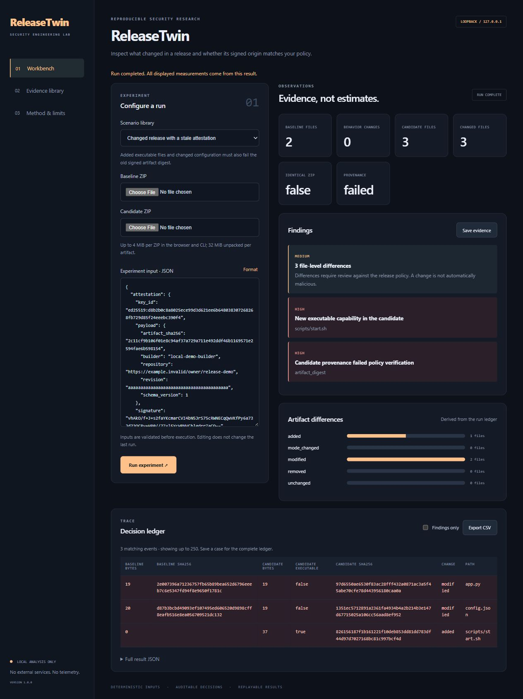

# ReleaseTwin

**Artifact differences, explicit provenance trust, and recorded behavior.**

[](https://github.com/Ashin-06/ReleaseTwin/actions/workflows/checks.yml)


ReleaseTwin answers three separate release-review questions: which files changed, whether a pinned signer authenticated these exact ZIP bytes and source claims, and whether independently supplied behavior traces differ.

It inventories ZIPs or stable local directory trees without extracting or executing their code, compares SHA-256 content and executable-mode changes, verifies Ed25519 signatures against a separately supplied trusted key and repository/revision/builder policy, and compares recorded exit codes/output digests.

Four fixtures distinguish a tampered artifact with an old signature, an identical trusted artifact, a legitimately signed change, and an identical artifact with inconsistent recorded behavior. A signature is evidence of a signer’s claim; it is not proof of source-to-binary equivalence or a malware verdict.

## Run locally

Requires Python 3.10+ on Windows, macOS, or Linux. Use a virtual environment. From the repository root:

```sh
python -m venv .venv
```

Activate with `.venv\Scripts\Activate.ps1` in PowerShell, or `source .venv/bin/activate` on macOS/Linux, then:

```sh
python -m pip install -e .
python -m releasetwin serve
```

Open **http://127.0.0.1:8763**. Select a scenario, edit JSON, run it, inspect findings and the decision ledger, export CSV, and save a replayable case. The Evidence library verifies saved cases and offers HTML reports and ZIP export. The UI is local, responsive, keyboard-accessible, and uses no external scripts or fonts.



## Reproduce from the CLI

```sh
python -m releasetwin demo --output .lab/demo-case
python -m releasetwin verify .lab/demo-case
python -m releasetwin bundle .lab/demo-case .lab/demo-case.zip
python -m releasetwin run examples/tampered.json --output .lab/custom-case
python -m releasetwin benchmark
```

Output destinations must be new; existing evidence is never overwritten. `presets` prints all runnable inputs. Run `python -m releasetwin --help` for the command reference. Exit code 0 means the command completed, 1 means evidence verification failed, and 2 means invalid input or an operational error. A completed experiment may contain findings; inspect the JSON summary rather than interpreting exit 0 as a clean security verdict.

Compare your own stable artifacts without signing:

```sh
python -m releasetwin compare baseline.zip candidate.zip --output .lab/release-review
```

For a signed review, create `policy.json` using the schema in [Method](docs/METHOD.md), obtain a trusted public key independently, then run:

```sh
python -m releasetwin keygen .lab/operator-keys
python -m releasetwin attest candidate.zip --private-key .lab/operator-keys/signing.private.pem --policy policy.json --out attestation.json
python -m releasetwin compare baseline.zip candidate.zip --attestation attestation.json --trusted-key .lab/operator-keys/trusted.public.pem --policy policy.json --output .lab/signed-review
```

The same operator creating and verifying a signature is a local demonstration. Real release review requires an independently trusted signer and policy.


## Evidence and methodology

Every saved case includes canonical input/result JSON, a standalone escaped HTML report, and a SHA-256 manifest. Verification checks hashes **and replays the experiment**. Reports display up to 200 ledger rows; the dashboard displays up to 250; result JSON retains the complete bounded ledger. CSV export includes all events matching the current filter and neutralizes spreadsheet formula prefixes.

- [Method, input contract, and limits](docs/METHOD.md)
- [Threat model](THREAT_MODEL.md)
- [Recorded benchmark results](docs/benchmark-results.json) — regenerate with `benchmark`
- [API and architecture](docs/ARCHITECTURE.md)
- [Contributing and validation](CONTRIBUTING.md)

## Validation

[Version 1.0.1 validation details](docs/VALIDATION.md) records regression coverage and the manual browser checks. Replay requires the software version recorded in the case manifest; use the matching release tag for older evidence.

```sh
python -m unittest discover -s tests -v
python -m pip install ruff
python -m ruff check --select F,E9 .
```

GitHub Actions runs tests, static checks, JavaScript syntax validation, and all fixture benchmarks on Python 3.10/3.12 for Windows and Ubuntu. Browser behavior is manually checked separately. These projects are research workbenches with explicit model limits; a passing fixture suite is not a production security assessment.

## License

[MIT](LICENSE). Maintained by [Ashin-06](https://github.com/Ashin-06).
